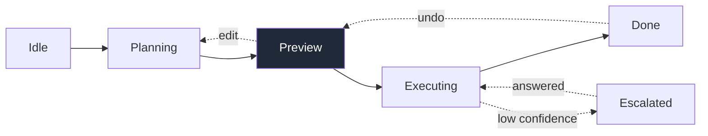
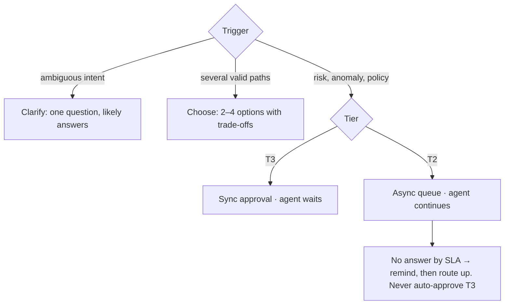

# Agentic UX visuals

The pattern skills produce specs as tables and prose. This skill turns them into a small set of visuals that a cross-functional team can align on in five minutes. **Only draw visuals for the patterns selected for this challenge.** A visual that restates a table without adding structure does not get made.

## Inputs

- The action inventory and risk tiers (from `agentic-ux`)
- The spec(s) from whichever pattern skills ran
- `brief/BRIEF.md` for product name, persona and language
- `output/scenarios.md` if `agentic-scenarios` ran

If an input is missing, say which visual it blocks. Don't invent data to fill it.

## Visual per pattern

| Pattern | Visual | What it must show | Primary reader |
|---|---|---|---|
| Router (always) | **Agent state diagram** | Happy path as one line; every correction or escalation as a dashed box that returns to the loop. No dead ends. | Eng |
| Router (always) | **Risk map** | Action inventory as a grid: actions on rows, tiers T0 to T3 as columns, the reason a tier was bumped noted inline | PM + Eng |
| Intent Preview | **Annotated preview** | The plan card at real size, numbered callouts for each anatomy part, Proceed / Edit / Do it myself | Design + Eng |
| Autonomy Dial | **Autonomy heatmap** | Action × level grid (observe, propose, confirm, autonomous). Default cell filled, allowed cells outlined, forbidden cells hatched. Promotion and demotion rules underneath. | PM |
| Explainable Rationale | **Rationale placement** | The same "because…" sentence shown in its three homes: preview, receipt, escalation prompt | Design |
| Confidence Signals | **Confidence strip** | One horizontal band: score ranges → label → UI treatment → gate behavior. A badge with no gate is drawn as a warning. | Eng + PM |
| Action Audit & Undo | **Recovery map** (see house format) | Every off-happy-path moment as a pattern card, grouped by journey stage | Everyone |
| Escalation Gates | **Escalation decision tree** | Trigger → kind (clarify / choose / approve) → sync or async → approver → timeout behavior | Eng |
| Generative UI | **Stable vs generated layout** | Wireframe with stable regions (controls, approvals, undo, stop) solid, generated regions tinted | Design + Eng |
| Scenarios | **Side-by-side storyboard** | Same task at two autonomy levels, frame by frame, with the divergence point marked | Panel |

## House format: the Recovery Map

This is the reference format, taken from the Carrito Listo case study. Reuse its structure; change the content.

1. **Header.** Eyebrow (product · surface · market), title, one paragraph: "How the agent behaves when it's unsure, wrong, blocked or out of context: what it does, what the user sees, how they correct it, and what that correction teaches the next time. The happy path is one line. This page is about everything else." Meta row: Type · Pairs with · Scenarios.
2. **01 · States.** The state diagram. One loop, with the agent's proposal at the center (highlighted). Corrections are dashed boxes that hang off the state where they happen and arrow back into the loop. Caption: "None of them is a dead end."
3. **02 · Recovery patterns.** Section title "N moments off the happy path". Legend of four tags:
   - `UNSURE`: the agent lacks the confidence or data to act
   - `WRONG`: the agent acted and the user corrected it
   - `BLOCKED`: policy, permission or availability stops the action
   - `CONTEXT SHIFT`: the world changed (season, event, user's circumstances)
   
   Group the cards under journey stages ("Before…", "In…", "At … and after"), each stage labeled with the states it attaches to. **Every card has the same five rows:**
   - **Trigger**: the rule that fires, stated so engineering could implement it
   - **Agent**: what the agent does, including what it does *not* do
   - **User sees**: the actual UI copy, rendered as a small mock (chips, buttons, inline notes), in production language with a gloss if it isn't English
   - **Way out**: how the user proceeds or corrects it
   - **Logs**: the event and what it teaches (`event → what changes downstream`)
4. **03 · What gets logged.** "Corrections become a small, fixed event vocabulary." Two or three code-style blocks showing event names and their enums. This is the hand-off to engineering and data science.
5. **Footer.** Where the copy, reason strings and event names come from (prototype, spec, assumption).

Aim for 6 to 12 cards. Fewer than 6 usually means the edge cases weren't explored; more than 12 usually means the cards repeat each other.

## Rendering

- **Source of truth is Markdown** in `output/artifacts/<name>.md`, with diagrams written in Mermaid (` ```mermaid `). GitHub renders Mermaid inline, so the repo is readable without a build.
- **The presentable version is HTML** in `output/readout/<name>.html`, using `output/readout/style.css`. Diagrams render with Mermaid from a pinned CDN version (`https://cdn.jsdelivr.net/npm/mermaid@11.4.1/dist/mermaid.min.js`), or inline SVG for anything Mermaid draws badly (the recovery map's dashed correction boxes, heatmaps).
- One visual per page or per section. Every visual has a one-line caption saying what to notice.
- Use text labels as well as color for tiers and tags, so the visuals work in grayscale and for color-blind readers.
- Keep the visual vocabulary consistent across pages: tier colors, tag colors, the highlighted "agent proposal" node, dashed = correction, solid = happy path, hatched = not allowed.

## Mermaid starters

State diagram (happy path plus corrections):



Escalation decision tree:



## Quality bar

Before handing over, check every visual:
- Could an engineer build from it without asking what a box means?
- Does every correction path return to the loop?
- Is every confidence signal connected to a gate?
- Is the copy in the "User sees" rows real UI copy, not a description of copy?
- Does it only cover the selected patterns?
